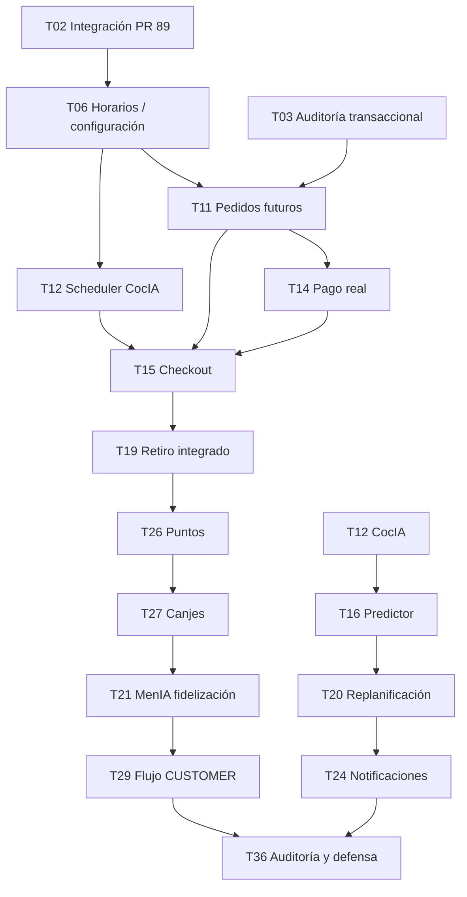

# TAKE&GO — Plan verificado de desarrollo pendiente y entrega final
**Fecha de auditoría:** 12/11/2026 · **Entrega objetivo:** 30/11/2026 · **Base funcional:** `TAKEANDGO_MASTER_V2_0(2).md` (V2.0, RN-001–RN-184) · **Repositorio:** https://github.com/Marilu-su/TakeAndGo

> **Alcance del término “verificado”.** Se inspeccionaron la estructura y archivos seleccionados de `develop` (`54b84064`), la documentación y los workflows, el estado del PR #89, y el diff de la rama `feature/C3-01-menia`. **No** se ejecutó la aplicación local completa, no se probó el proveedor de pagos real ni se verificó la URL pública de producción. Estado = evidencia de código, no necesariamente comportamiento correcto. Los hallazgos pueden cambiar al integrar ramas.

## 1. Alcance pendiente y estado real

### Evidencia concreta, a reutilizar (no reconstruir)
- **`develop`**: API Node/TypeScript + Express, Prisma/PostgreSQL, Neon Auth, organizaciones, buffets, asociación, catálogo, adicionales, pedidos/reservas, inventario, casos de uso de pago, cocina y QR/manual, frontend inicial y tests. `apps/api/src/app.ts` registra rutas de pedidos/cocina/retiro, **pero no expone módulo de pagos**, pese a existir sus casos de uso.
- **PR #89 abierto, no fusionado** (`feature/C2-frontend-rutas-base`): gestión adicional de organización/personal, preferencias alimentarias, ajustes stock, cola cocina/retirada y UI. Su rama diverge de `develop`, de modo que **T02** debe auditar e integrar antes de usarlo como base estable.
- **Rama MenIA `feature/C3-01-menia` no integrada**: endpoint, chat, pruebas y responder determinístico. **No equivale a MenIA con LLM/STT/recomendaciones/canje completo**. Reutilizar con T01 y ampliar en T09/T13/T17/T21.
- **Pruebas**: el registro del equipo indica 326 OK + 3 omitidas en una ejecución de 329. API CI en `develop` informó éxito el 09/11. Son evidencias parciales, no una certificación RN-001–184.
- **Infraestructura**: workflow frontend a Vercel existe pero su ejecución sobre `develop` del 09/11 falló; no se verificó API de producción. Ramas `main`/`develop` figuran sin protección. `docs/tdds/` no contiene TDDs funcionales en el árbol consultado.

### Gap por producto
| Bloque | Estado evidenciado | Pendiente verificable | Tareas |
|---|---|---|---|
| Acceso, multi-buffet y perfil | Base lista; preferencias del PR #89 parciales | recovery, exclusiones, rutina, historial global, permisos efectivos | T05,T08,T34 |
| Administración y catálogo | CRUD y scopes en develop; extensiones PR #89 | horarios, cierre, activación, staff, auditoría stock, dashboards | T02,T06,T07,T10,T30 |
| Pedidos, ventanas y pago | Reservas, órdenes, modelos de pago | fecha futura, capacidad, checkout virtual, webhooks, jobs de expiración | T03,T11,T14,T15 |
| CocIA y operación | Iniciar/finalizar cocina, QR y cola UI en PR #89 | predictor, scheduler, ventas presenciales, replanificación, retiro combinado | T12,T16,T18,T19,T20 |
| MenIA | Chat/endpoint en rama no integrada | LLM, STT, reglas de recomendaciones y confirmaciones, planificación semanal | T01,T09,T13,T17,T21 |
| No retiro, reciclaje, sanciones | No se identificaron módulos integrados en develop | aviso previo, strikes/rehabilitación, unidad recuperada, descarte | T22,T23 |
| Fidelización | No se identificaron entidades integradas en Prisma revisado | puntos, recompensas, canje físico y beneficio de 10% | T26,T27,T28,T21,T25 |
| Notificaciones y cierre | No se identificó notificación integrada | in-app/push, observabilidad, despliegue, QA y defensa | T24,T32–T36 |

**Principio de planificación:** se prioriza integración de trabajo existente antes de desarrollar de nuevo. No se declara terminado un módulo por sus archivos, un commit o un test unitario aislado. Los TDD/contratos se escriben o actualizan dentro de la tarea correspondiente y quedan enlazados en la matriz T04.

## 2. Mapa general de dependencias (ruta crítica)

**Lectura:** `Depende de` = bloqueo duro para terminar la tarea (el relevamiento, mocks o diseño pueden empezar antes). `Desbloquea a` = tareas cuya definición incluye este ID como dependencia. No todas las tareas pertenecen a la ruta crítica temporal: sin estimación de horas por integrante no puede afirmarse una ruta crítica única.

### Etapa A — Auditoría e integración inicial (cuatro arranques paralelos)
- **[T01] Auditar e integrar MenIA existente** | Depende de: Ninguna | Desbloquea a: T05, T09 | Responsable: **Brenda**
- **[T02] Integrar PR #89 y controlar regresiones** | Depende de: Ninguna | Desbloquea a: T05, T06, T07, T10, T18, T19 | Responsable: **Maca**
- **[T03] Auditoría transaccional de pedidos/pagos/stock/retiro** | Depende de: Ninguna | Desbloquea a: T07, T11, T12, T14 | Responsable: **Lauti**
- **[T04] Auditoría de cumplimiento, GitHub y despliegue** | Depende de: Ninguna | Desbloquea a: T08 | Responsable: **Yo**

### Etapa B — Completar bases funcionales
- **[T05] Perfil global, exclusiones, rutina e historial** | Depende de: T01, T02 | Desbloquea a: T09, T13, T25 | Responsable: **Brenda**
- **[T06] Configuración operativa del buffet y horarios** | Depende de: T02 | Desbloquea a: T10, T11, T12 | Responsable: **Maca**
- **[T07] Stock: restock, ajustes auditables y revisión semanal** | Depende de: T03, T02 | Desbloquea a: T23 | Responsable: **Lauti**
- **[T08] Asegurar base técnica: acceso, CI, documentación y entornos** | Depende de: T04 | Desbloquea a: T32 | Responsable: **Yo**
- **[T09] MenIA: adaptador LLM, herramientas seguras y confirmaciones** | Depende de: T01, T05 | Desbloquea a: T13, T17 | Responsable: **Brenda**
- **[T10] Empleados, gobierno de buffets y administración base** | Depende de: T02, T06 | Desbloquea a: T30 | Responsable: **Maca**
- **[T11] Pedidos futuros, ventanas y restricciones operativas** | Depende de: T03, T06 | Desbloquea a: T13, T14, T15, T19, T20, T22 | Responsable: **Lauti**
- **[T12] CocIA: motor determinístico y capacidad** | Depende de: T03, T06 | Desbloquea a: T13, T15, T16, T18, T19, T20 | Responsable: **Yo**

### Etapa C — Pedido, IA y operación completa
- **[T13] MenIA: catálogo y recomendaciones filtradas** | Depende de: T05, T09, T11, T12 | Desbloquea a: T17, T21 | Responsable: **Brenda**
- **[T14] Pago virtual integrado: intents, eventos y expiración** | Depende de: T03, T11 | Desbloquea a: T15, T18, T28, T31, T32 | Responsable: **Maca**
- **[T15] Conectar cotización/checkout y pagos con UI** | Depende de: T11, T12, T14 | Desbloquea a: T17, T27, T28, T31 | Responsable: **Lauti**
- **[T16] CocIA: predictor gestionado, calibración y fallback** | Depende de: T12 | Desbloquea a: T20, T32 | Responsable: **Yo**
- **[T17] MenIA: audio, pedidos y planificación semanal** | Depende de: T09, T13, T15 | Desbloquea a: T29 | Responsable: **Brenda**
- **[T18] Cocina operativa: cola completa y venta presencial** | Depende de: T02, T12, T14 | Desbloquea a: T19, T20, T30 | Responsable: **Maca**
- **[T19] Retiro: ventana real, QR/manual y operación combinada** | Depende de: T02, T11, T12, T18 | Desbloquea a: T22, T23, T24, T26, T27, T31 | Responsable: **Lauti**
- **[T20] Replanificación CocIA, nuevas ventanas y eventos** | Depende de: T11, T12, T16, T18 | Desbloquea a: T24 | Responsable: **Yo**

### Etapa D — Posventa, sanciones, puntos y recompensas
- **[T21] MenIA: saldo, recompensas y acciones confirmadas** | Depende de: T13, T26, T27, T28 | Desbloquea a: T25, T29 | Responsable: **Brenda**
- **[T22] No retiro, aviso anticipado y sanciones por organización** | Depende de: T11, T19 | Desbloquea a: T23, T25, T30, T31 | Responsable: **Maca**
- **[T23] Unidades recuperadas, reventa y desperdicio** | Depende de: T07, T19, T22 | Desbloquea a: T30, T31 | Responsable: **Lauti**
- **[T24] Notificaciones in-app y push** | Depende de: T19, T20 | Desbloquea a: T25, T32 | Responsable: **Yo**
- **[T25] Cliente: historial global, puntos, canjes y estados bloqueados** | Depende de: T05, T21, T22, T24 | Desbloquea a: T29 | Responsable: **Brenda**
- **[T26] Puntos: cuenta, movimientos e idempotencia** | Depende de: T19 | Desbloquea a: T21, T27, T28, T30 | Responsable: **Maca**
- **[T27] Recompensas físicas y canjes transaccionales** | Depende de: T15, T19, T26 | Desbloquea a: T21, T30, T31 | Responsable: **Lauti**
- **[T28] Beneficio 10%: activación, uso, expiración, restauración** | Depende de: T14, T15, T26 | Desbloquea a: T21, T29, T31 | Responsable: **Yo**

### Etapa E — Integración final, despliegue y defensa
- **[T29] Integración MenIA y recorrido CUSTOMER completo** | Depende de: T17, T21, T25, T28 | Desbloquea a: T33, T36 | Responsable: **Brenda**
- **[T30] Dashboards operativos y administración de sanciones** | Depende de: T10, T18, T22, T23, T26, T27 | Desbloquea a: T34, T36 | Responsable: **Maca**
- **[T31] Pruebas E2E transaccionales y casos límite** | Depende de: T14, T15, T19, T22, T23, T27, T28 | Desbloquea a: T35, T36 | Responsable: **Lauti**
- **[T32] Producción cloud, CI/CD y observabilidad** | Depende de: T08, T14, T16, T24 | Desbloquea a: T34, T35, T36 | Responsable: **Yo**
- **[T33] QA de UX y accesibilidad en las 39 pantallas** | Depende de: T29 | Desbloquea a: T36 | Responsable: **Brenda**
- **[T34] QA de roles y flujos administrativos** | Depende de: T30, T32 | Desbloquea a: T36 | Responsable: **Maca**
- **[T35] Cierre de integridad y flujos no-retirados** | Depende de: T31, T32 | Desbloquea a: T36 | Responsable: **Lauti**
- **[T36] Matriz final RN-001–184, demo y defensa** | Depende de: T29, T30, T31, T32, T33, T34, T35 | Desbloquea a: — | Responsable: **Yo**

### Ruta crítica lógica (bloqueos que conviene vigilar)

**Paralelismo real:** T01–T04 arrancan juntos; después T05/T06/T07/T08 avanzan en paralelo. No hace falta esperar MenIA para avanzar en pagos ni esperar pagos para construir predictor CocIA. El sistema de puntos sí depende de un retiro consistente; los canjes dependen de saldo y de reservas/retirada.

## 3. Lista de tareas por integrante

### Brenda

#### T01 — Auditar e integrar MenIA existente
**Breve descripción:** Revisar la rama MenIA para preservar el código ya escrito y separar lo que es base conversacional de las reglas funcionales que aún faltan.
**Evidencia y alcance:** Rama feature/C3-01-menia: API/chat/tests; NO integrada a develop · **Master:** RN-036–053; RN-156–158 · **Tamaño relativo:** M (S/M/L; estimación cualitativa, no horas).
**Qué hay que hacer (paso a paso):**
1. Revisar diff de feature/C3-01-menia contra develop, endpoints, chat, tests y documento docs/C3-01-MENIA.md.
2. Registrar qué partes son determinísticas y cuáles necesitan LLM, STT y herramientas del backend.
3. Preparar PR de integración con resolución de conflictos; no declararla completa por el nombre de la rama.
4. Documentar brechas contra RN-036–053 y el contrato de tools RN del Master.
**Pre-requisitos (dependencias):** Ninguna: comenzar el día 1.
**Criterio de terminado:** Existe revisión de código, matriz de brechas MenIA y PR integrable con pruebas verdes; sin fingir que ya hay IA real.

#### T05 — Perfil global, exclusiones, rutina e historial
**Breve descripción:** Completar datos personales, preferencias por concepto, exclusiones por producto/ingrediente, restricciones y rutina semanal con confirmación.
**Evidencia y alcance:** PR #89 añade dietaryRestrictions/allergies; no cubre por sí solo preferencias/rutina completas · **Master:** RN-016–025; RN-020 · **Tamaño relativo:** L (S/M/L; estimación cualitativa, no horas).
**Qué hay que hacer (paso a paso):**
1. Reutilizar endpoints y pantalla de preferencias del PR #89; comparar enumeraciones Sin TACC/Vegetariano/Vegano.
2. Implementar preferencias, exclusiones y rutina semanal global; excepciones y presupuesto solo contextuales.
3. Completar historial global filtrable por organización/buffet/estado e incluir operaciones relevantes.
4. Agregar confirmación estructurada para cambios persistentes iniciados por MenIA y pruebas de tenant/usuario.
**Pre-requisitos (dependencias):** T01, T02.
**Criterio de terminado:** Perfil e historial global verificables; preferencias no bloquean pedidos explícitos y exclusiones/dieta operan como filtros duros.

#### T09 — MenIA: adaptador LLM, herramientas seguras y confirmaciones
**Breve descripción:** Pasar del chat base a interpretación asistida por LLM conservando la autoridad del backend.
**Evidencia y alcance:** Rama MenIA solo evidencia responder determinístico y estructura de chat · **Master:** RN-036–039; RN-051–052; RN-015; RN-025 · **Tamaño relativo:** L (S/M/L; estimación cualitativa, no horas).
**Qué hay que hacer (paso a paso):**
1. Definir provider gestionado y adaptador; nunca ejecutar escrituras por texto libre.
2. Exponer tools con actor+buffet: catálogo, perfil, cotización, pedido, saldo, recompensas y propuestas.
3. Diseñar cards de confirmación estructurada para toda escritura; chat sin historial persistente.
4. Controlar horario digital: “MenIA está durmiendo”; probar intentos maliciosos y cambios de buffet.
**Pre-requisitos (dependencias):** T01, T05.
**Criterio de terminado:** Chat conversa mediante servicio de IA o fallback explícito; escritura solo mediante API validada y confirmación estructurada.

#### T13 — MenIA: catálogo y recomendaciones filtradas
**Breve descripción:** Ofrecer catálogo completo o hasta cuatro recomendaciones válidas con dieta, precio, tiempo, stock y preferencias.
**Evidencia y alcance:** develop catálogo disponible; MenIA branch todavía sin recomendaciones completas · **Master:** RN-040–050; RN-018–021 · **Tamaño relativo:** L (S/M/L; estimación cualitativa, no horas).
**Qué hay que hacer (paso a paso):**
1. Conectar tools de catálogo con disponibilidad del buffet, adicionales y precios.
2. Filtrar incompatibles (dieta, exclusiones, stock, presupuesto contextual, horarios); ordenar preferencias e historial.
3. Respetar máximo 4 recomendaciones excepto catálogo completo; alternativas si stock/hora falla.
4. Renderizar cards con precios, ventana posible y selección; probar respuestas LLM contra datos backend.
**Pre-requisitos (dependencias):** T05, T09, T11, T12.
**Criterio de terminado:** Ni MenIA ni sus cards ofrecen productos incompatibles/agostados; se ofrecen solo horarios factibles y hasta cuatro opciones.

#### T17 — MenIA: audio, pedidos y planificación semanal
**Breve descripción:** Completar interacción por voz y flujos conversacionales de pedido, horario futuro y plan semanal sin confirmar automáticamente.
**Evidencia y alcance:** Rama MenIA incluye chat de texto; no consta STT ni planning semanal final · **Master:** RN-037–039; RN-048–053 · **Tamaño relativo:** L (S/M/L; estimación cualitativa, no horas).
**Qué hay que hacer (paso a paso):**
1. Integrar speech-to-text gestionado y estados de carga/error; transcribir antes de cualquier decisión.
2. Permitir MenIA generar propuesta de pedido, cotización, selección fecha/ventana y card de confirmación.
3. Proponer semana según rutina sin crear pedidos por sí sola; cada pedido requiere confirmación y fecha legal.
4. Validar no persistencia de chat, cambio de buffet y MenIA durmiendo.
**Pre-requisitos (dependencias):** T09, T13, T15.
**Criterio de terminado:** Usuario puede hablar, consultar, armar pedido y confirmar solo con componentes estructurados; plan semanal no compra solo.

#### T21 — MenIA: saldo, recompensas y acciones confirmadas
**Breve descripción:** Usar servicios de fidelización ya implementados para que MenIA muestre el saldo correcto y guíe canjes seguros.
**Evidencia y alcance:** No hay módulo Loyalty en develop; la tool MenIA está por completar · **Master:** RN-039; RN-149–159; RN-173–182 · **Tamaño relativo:** M (S/M/L; estimación cualitativa, no horas).
**Qué hay que hacer (paso a paso):**
1. Conectar getOrganizationBalance, getEligibleRewards y tools de canje al buffet activo.
2. Mostrar solo recompensas alcanzables/ofrecidas/con stock y excluir 10% ya activo.
3. Proponer selección física y beneficio con confirmación estructurada, sin interpretar sí libre.
4. Probar saldo entre buffets de misma organización y bloqueo por sanciones.
**Pre-requisitos (dependencias):** T13, T26, T27, T28.
**Criterio de terminado:** MenIA consulta/canjea puntos por organización con filtrado backend; no crea canjes ni beneficios sin confirmación.

#### T25 — Cliente: historial global, puntos, canjes y estados bloqueados
**Breve descripción:** Cerrar la experiencia CUSTOMER alrededor de MenIA e historial incluyendo todas las operaciones.
**Evidencia y alcance:** develop tiene Home/buffets/pedidos; falta experiencia final de rewards y bloqueo · **Master:** RN-011–025; RN-130; RN-148; mapa pantallas 3–22 · **Tamaño relativo:** L (S/M/L; estimación cualitativa, no horas).
**Qué hay que hacer (paso a paso):**
1. Completar accesos globales, filtros del historial y movimientos de puntos.
2. Añadir seguimiento y QR, avisos previos, nueva ventana, pantalla bloqueada y notificaciones.
3. Implementar pantallas de saldo/canje activo/beneficio 10% con loading, empty, error, vencido.
4. Realizar revisión responsive mobile-first y pruebas básicas de interacción.
**Pre-requisitos (dependencias):** T05, T21, T22, T24.
**Criterio de terminado:** Todas las pantallas CUSTOMER obligatorias existen y funcionan con datos reales/estados correctos, no mocks finales.

#### T29 — Integración MenIA y recorrido CUSTOMER completo
**Breve descripción:** Completar el flujo real desde buffet seleccionado hasta pedido pagado, seguimiento, retiro, puntos y canje.
**Evidencia y alcance:** frontend parcial en develop y dos ramas de integración · **Master:** RN-036–053; RN-156–184; mapa CUSTOMER · **Tamaño relativo:** L (S/M/L; estimación cualitativa, no horas).
**Qué hay que hacer (paso a paso):**
1. Eliminar accesos que eviten las validaciones de MenIA/Backend al comprar; revisar flujo conversacional end-to-end.
2. Integrar estados de pago, QR, replanificación, descuentos, canje y bloqueo.
3. Verificar no proactividad de MenIA, sin historial persistido, horarios de dormir y errores de proveedor.
4. Ejecutar suite de interfaz con dos organizaciones y dos buffets.
**Pre-requisitos (dependencias):** T17, T21, T25, T28.
**Criterio de terminado:** Escenarios CUSTOMER del Master recorribles en entorno desplegado y con servicios reales/sandbox acreditados.

#### T33 — QA de UX y accesibilidad en las 39 pantallas
**Breve descripción:** ['Recorrer 39 pantallas para los cuatro perfiles, con usuario activo/bloqueado', 'Verificar loading/empty/error/sin stock/no horario/pago/beneficio vencido/MenIA durmiendo/CocIA fallback', 'Ajustar layouts mobile-first CUSTOMER y tablet/desktop para cocina/admin', 'Registrar capturas y fallos con reproducibilidad y cerrar regresiones']
**Evidencia y alcance:** Convertir el mapa de pantallas en checklist verificable antes de la defensa. · **Master:** PANTALLAS_V2_0 completo · **Tamaño relativo:** M (S/M/L; estimación cualitativa, no horas).
**Qué hay que hacer (paso a paso):**
1. C.
2. h.
3. e.
4. c.
5. k.
6. l.
7. i.
8. s.
9. t.
10.  .
11. d.
12. e.
13.  .
14. p.
15. a.
16. n.
17. t.
18. a.
19. l.
20. l.
21. a.
22. s.
23.  .
24. y.
25.  .
26. e.
27. s.
28. t.
29. a.
30. d.
31. o.
32. s.
33.  .
34. f.
35. i.
36. r.
37. m.
38. a.
39. d.
40. o.
41. ,.
42.  .
43. s.
44. i.
45. n.
46.  .
47. f.
48. a.
49. l.
50. l.
51. o.
52. s.
53.  .
54. c.
55. r.
56. í.
57. t.
58. i.
59. c.
60. o.
61. s.
62.  .
63. d.
64. e.
65.  .
66. n.
67. a.
68. v.
69. e.
70. g.
71. a.
72. c.
73. i.
74. ó.
75. n.
76.  .
77. o.
78.  .
79. e.
80. x.
81. p.
82. o.
83. s.
84. i.
85. c.
86. i.
87. ó.
88. n.
89.  .
90. d.
91. e.
92.  .
93. a.
94. c.
95. c.
96. i.
97. o.
98. n.
99. e.
100. s.
101.  .
102. p.
103. r.
104. o.
105. h.
106. i.
107. b.
108. i.
109. d.
110. a.
111. s.
112. ..
**Pre-requisitos (dependencias):** T29.
**Criterio de terminado:** M

### Maca

#### T02 — Integrar PR #89 y controlar regresiones
**Breve descripción:** Recuperar mejoras recientes de perfil, buffet, stock y pantalla de cocina sin perder cambios ya integrados.
**Evidencia y alcance:** PR #89 abierto; divergente: 5 commits adelante, 1 atrás de develop · **Master:** RN-016–035; RN-107–119 · **Tamaño relativo:** L (S/M/L; estimación cualitativa, no horas).
**Qué hay que hacer (paso a paso):**
1. Revisar todos los archivos del PR #89 y su alcance real, incluyendo migraciones.
2. Reconciliar feature/C2-frontend-rutas-base con develop; resolver conflictos y validar contratos.
3. Correr typecheck, pruebas de API/web, migraciones y smoke test por rol.
4. Solicitar revisión cruzada y fusionar a develop solo con CI verde.
**Pre-requisitos (dependencias):** Ninguna: comenzar el día 1.
**Criterio de terminado:** PR #89 fusionado con revisión, CI verde y verificación de preferencias, cocina, stock y administración; si falla, registrar bloqueo.

#### T06 — Configuración operativa del buffet y horarios
**Breve descripción:** Completar el formulario de habilitación del buffet, horarios, cierres y parámetros configurables sin duplicar catálogo existente.
**Evidencia y alcance:** develop: Store + maxAdvanceDays; PR #89 agrega gestión parcial · **Master:** RN-026–035; RN-054–055; RN-059; RN-097–100 · **Tamaño relativo:** L (S/M/L; estimación cualitativa, no horas).
**Qué hay que hacer (paso a paso):**
1. Agregar StoreOperatingHours por día y excepciones fecha: openAt/digitalOrderCloseAt/closeAt y zona horaria.
2. Crear validaciones y estados PENDING_SETUP/ACTIVE: impedir pedidos si falta configuración.
3. Añadir edición administrativa de parámetros CocIA de adicionales, cantidades y penalización por carga.
4. Mantener scope STORE_ADMIN único buffet, protección backend y pruebas de cambios de horario.
**Pre-requisitos (dependencias):** T02.
**Criterio de terminado:** Buffet configurable, se activa solo tras completar mínimos; horarios y parámetros persistidos y usados por backend.

#### T10 — Empleados, gobierno de buffets y administración base
**Breve descripción:** Cerrar los procesos administrativos necesarios para operar sin scripts manuales cotidianos.
**Evidencia y alcance:** develop staff scopes + script; PR #89 integra pantallas de staff · **Master:** RN-026–035; RN-112 · **Tamaño relativo:** M (S/M/L; estimación cualitativa, no horas).
**Qué hay que hacer (paso a paso):**
1. Completar creación/asignación/desactivación STORE_EMPLOYEE desde STORE_ADMIN y reemplazo STORE_ADMIN desde organización.
2. Validar que cada STORE_ADMIN maneje un único buffet; STORE_EMPLOYEE no edite precios/catálogo/parametría.
3. Completar altas/bajas de buffet y configuración de organización con límite de días.
4. Probar denegaciones cross-tenant, cuenta desactivada y actualización de permisos.
**Pre-requisitos (dependencias):** T02, T06.
**Criterio de terminado:** Los dos roles administrativos operan desde UI con permisos correctos y cambios persistidos.

#### T14 — Pago virtual integrado: intents, eventos y expiración
**Breve descripción:** Conectar una pasarela real o sandbox verificable y exponer el circuito pago-orden-stock de extremo a extremo.
**Evidencia y alcance:** develop payment use cases y adapters; app.ts no registra rutas de payment · **Master:** RN-068–077; RN-070–075 · **Tamaño relativo:** L (S/M/L; estimación cualitativa, no horas).
**Qué hay que hacer (paso a paso):**
1. Seleccionar y justificar proveedor; implementar adapter PaymentPort/RefundPort y endpoints de creación/consulta.
2. Conectar reserva RESERVADO + pago PENDIENTE con 5:00 y confirmación de webhook autenticado e idempotente.
3. Aprobación -> CONFIRMADO y consolidación sin doble reserva; rechazo/expiración -> CANCELADO/liberación automática.
4. Tratar aprobación tardía con compensación y auditar reembolsos sin reactivar pedidos.
**Pre-requisitos (dependencias):** T03, T11.
**Criterio de terminado:** Pago sandbox completo mediante UI/API: aprobado, rechazado, expirado, duplicado y tardío, con stock consistente.

#### T18 — Cocina operativa: cola completa y venta presencial
**Breve descripción:** Cerrar flujo del STORE_EMPLOYEE con cola planificada y venta presencial transaccional.
**Evidencia y alcance:** develop kitchen API; PR #89 KitchenQueue de pedidos, sin venta presencial completa · **Master:** RN-094–095; RN-107–112 · **Tamaño relativo:** L (S/M/L; estimación cualitativa, no horas).
**Qué hay que hacer (paso a paso):**
1. Integrar pantalla de cola del PR #89; priorizar por recommendedStartAt, hora prometida y tipos de operación.
2. Mostrar estimación, estados, pedidos y canjes; start/finish y habilitación PARA_RETIRAR en ventana.
3. Implementar VENTA_PRESENCIAL sin CUSTOMER, pago comercial inmediato, consumo stock y ticket si requiere cocina.
4. Verificar que ventas presenciales participen en carga CocIA y no permitan alterar precios.
**Pre-requisitos (dependencias):** T02, T12, T14.
**Criterio de terminado:** Empleado atiende cola y ventas presenciales desde UI; stock, carga y estados quedan consistentes.

#### T22 — No retiro, aviso anticipado y sanciones por organización
**Breve descripción:** Implementar cierre por tolerancia y política de strikes/advertencias/bloqueos.
**Evidencia y alcance:** develop no evidencia OrganizationDiscipline/noShowNoticeAt · **Master:** RN-120–131 · **Tamaño relativo:** L (S/M/L; estimación cualitativa, no horas).
**Qué hay que hacer (paso a paso):**
1. Crear operación de aviso con timestamp antes de inicio ventana; nunca prometer reembolso.
2. Al pasar toleranceUntil sin retiro ejecutar NO_RETIRADO idempotente y sumar strike salvo aviso previo.
3. Modelar por organización 3 strikes -> bloqueo, rehabilitar -> 0 strikes + warning, 2 warnings -> permanente.
4. Bloquear transacciones sin bloquear historial/puntos ni otras organizaciones; pruebas de relojes y carreras.
**Pre-requisitos (dependencias):** T11, T19.
**Criterio de terminado:** Fin de tolerancia ejecuta cierre una sola vez; sanciones por organización y rehabilitación cumplen RN-120–131.

#### T26 — Puntos: cuenta, movimientos e idempotencia
**Breve descripción:** Crear el saldo por organización y acreditar puntos por puntualidad del retiro de pedidos normales.
**Evidencia y alcance:** develop Prisma sin LoyaltyAccount/PointMovement en esquema revisado · **Master:** RN-137–148 · **Tamaño relativo:** L (S/M/L; estimación cualitativa, no horas).
**Qué hay que hacer (paso a paso):**
1. Crear OrganizationLoyaltyAccount y PointMovement inmutable; no expiración de saldo.
2. Acreditar 10/7/5/3 puntos según límites exactos de minuto, o 0 por no retiro.
3. Usar ventana vigente tras replanificación y no acreditar dos veces; 10% no elimina puntos.
4. Exponer consulta por organización e historial global; verificar transacciones y concurrentes.
**Pre-requisitos (dependencias):** T19.
**Criterio de terminado:** Puntos acreditados una sola vez, compartidos por buffets de misma organización y con ledger auditable.

#### T30 — Dashboards operativos y administración de sanciones
**Breve descripción:** Completar paneles STORE_ADMIN/ORGANIZATION_ADMIN con métricas respaldadas por operaciones reales.
**Evidencia y alcance:** develop carece de KPIs consolidados y UI de sanciones completa · **Master:** RN-026–035; RN-125–130; mapa pantallas 28–39 · **Tamaño relativo:** M (S/M/L; estimación cualitativa, no horas).
**Qué hay que hacer (paso a paso):**
1. Dashboard buffet: pedidos, ventas, carga, no-retirados, recuperados/desperdicio.
2. Dashboard organización: buffets, ventas consolidadas, pedidos, pérdidas y sanciones.
3. Pantalla de strikes/warnings, bloqueo y rehabilitación de Customer autorizada.
4. Comprobar métricas por rango/tenant y estados empty/error.
**Pre-requisitos (dependencias):** T10, T18, T22, T23, T26, T27.
**Criterio de terminado:** KPIs cruzan datos reales; un administrador no ve datos de otra organización y puede rehabilitar conforme RN.

#### T34 — QA de roles y flujos administrativos
**Breve descripción:** Ejecutar pruebas reales de permisos/tenancy y configuración de organizaciones y buffets.
**Evidencia y alcance:** auth con roles implementados parcialmente, no validación humana completa · **Master:** RN-001–035; RN-112; RN-124–130 · **Tamaño relativo:** M (S/M/L; estimación cualitativa, no horas).
**Qué hay que hacer (paso a paso):**
1. Probar registros, recovery, asociación múltiples organizaciones y denegaciones cross-tenant.
2. Validar STORE_ADMIN un buffet, empleados sin privilegios y ORGANIZATION_ADMIN dentro de su organización.
3. Probar alta/configuración/activación de buffets y rehabilitación de clientes bloqueados.
4. Levantar y resolver issues de severidad alta; guardar resultados para defensa.
**Pre-requisitos (dependencias):** T30, T32.
**Criterio de terminado:** Cuatro perfiles probados con evidencia funcional y negativa, sin acceso de datos/acciones entre tenants.

### Lauti

#### T03 — Auditoría transaccional de pedidos/pagos/stock/retiro
**Breve descripción:** Inventariar lo que el backend efectivamente garantiza, sin reescribir operaciones transaccionales existentes.
**Evidencia y alcance:** develop: modules order/payment/stock/kitchen/pickup + Prisma + tests · **Master:** RN-054–091; RN-113–119 · **Tamaño relativo:** M (S/M/L; estimación cualitativa, no horas).
**Qué hay que hacer (paso a paso):**
1. Leer casos de uso, rutas registradas en app.ts y persistencia de order/payment/stock/pickup.
2. Verificar consistencia de estados, expiración y concurrencia contra Master; distinguir código interno de endpoint accesible.
3. Ejecutar o inspeccionar pruebas relevantes y listar escenarios faltantes.
4. Preparar matriz ruta/caso de uso/RN/prueba/evidencia y brechas prioritarias.
**Pre-requisitos (dependencias):** Ninguna: comenzar el día 1.
**Criterio de terminado:** Existe matriz de brechas por módulo con rutas y pruebas comprobables; quedan identificados riesgos de stock, pago y retiro.

#### T07 — Stock: restock, ajustes auditables y revisión semanal
**Breve descripción:** Conservar el inventario transaccional y completar operaciones administrativas, auditoría y revisión de los lunes.
**Evidencia y alcance:** develop tiene reservas/consumo/GET stock; PR #89 añade ajuste y auditoría parcial · **Master:** RN-079–084; RN-090–091 · **Tamaño relativo:** M (S/M/L; estimación cualitativa, no horas).
**Qué hay que hacer (paso a paso):**
1. Revisar merge del PR #89 de ajustes de stock y su migración de auditoría.
2. Implementar o completar restock/ajuste delta, actor, razón, timestamp y movimientos de producto/adicional.
3. Distinguir stock controlado/no controlado y verificar indisponibilidad sin filtraciones entre buffets.
4. Agregar acción de revisión operativa de lunes y pruebas de concurrencia, límites y rollback.
**Pre-requisitos (dependencias):** T03, T02.
**Criterio de terminado:** Restock/ajustes auditables en API/UI y pruebas de no sobreventa, no stock negativo e historial de movimientos.

#### T11 — Pedidos futuros, ventanas y restricciones operativas
**Breve descripción:** Extender el pedido existente para aceptar fecha y ventana factible, incluida la reserva de compromisos futuros.
**Evidencia y alcance:** develop crea reservas/pedidos; no se verificó planificación futura completa · **Master:** RN-054–067; RN-078; RN-106 · **Tamaño relativo:** L (S/M/L; estimación cualitativa, no horas).
**Qué hay que hacer (paso a paso):**
1. Agregar/validar scheduledForDate, promisedFrom/To, toleranceUntil en dominio/API/Prisma.
2. Imponer máximo días org (7 default), horarios diarios, cierre operativo, ventana 5 + tolerancia 5 y anticipación >=15 minutos.
3. Considerar margen de pago de 5 minutos al cotizar, pedido completo en ventana única y bloqueo de solapamiento activo.
4. Probar horarios límite, DST/timezone del buffet, días futuros y reserva concurrente.
**Pre-requisitos (dependencias):** T03, T06.
**Criterio de terminado:** La API rechaza ventanas inválidas y reserva pedidos futuros válidos sin violar compromisos ni horarios.

#### T15 — Conectar cotización/checkout y pagos con UI
**Breve descripción:** Convertir carrito y reserva existentes en checkout real, usando los cálculos de backend y ventanas válidas.
**Evidencia y alcance:** develop frontend carrito y pedido reservado; pago aún no está conectado al usuario · **Master:** RN-056–078; RN-082–083 · **Tamaño relativo:** L (S/M/L; estimación cualitativa, no horas).
**Qué hay que hacer (paso a paso):**
1. Crear endpoint de cotización/ventanas ligado a CocIA y horario.
2. Actualizar UI de propuesta/confirmación, fecha/hora, 5-min countdown, pago y estados.
3. Revalidar precio, adicionales, stock y sanciones al confirmar; impedir cancelación del CUSTOMER post-pago.
4. Probar expiración de reserva, diferencia stock e intentos simultáneos.
**Pre-requisitos (dependencias):** T11, T12, T14.
**Criterio de terminado:** El cliente pasa desde propuesta a pago y pedido confirmado; errores muestran causa precisa y no dejan reservas huérfanas.

#### T19 — Retiro: ventana real, QR/manual y operación combinada
**Breve descripción:** Conectar retiro al calendario real y preparar retiro combinado sin romper operaciones separadas.
**Evidencia y alcance:** develop pickup QR/token de un uso; PR #89 aporta UI de confirmación básica · **Master:** RN-064–065; RN-113–119; RN-164 · **Tamaño relativo:** M (S/M/L; estimación cualitativa, no horas).
**Qué hay que hacer (paso a paso):**
1. Evitar habilitar QR antes de ready + comienzo de ventana; conservar readyAt y expiración.
2. Integrar QR y código manual en ambas interfaces y validar empleado/buffet/estado/uso único.
3. Construir agrupación visual de pedido + canje coincidentes sin fusionar entidades ni movimientos.
4. Agregar tests de QR temprano/vencido, duplicado, otro buffet y retiro manual auditado.
**Pre-requisitos (dependencias):** T02, T11, T12, T18.
**Criterio de terminado:** La entrega solo se confirma con credencial válida dentro de la operación permitida, stock consumido una vez y auditado.

#### T23 — Unidades recuperadas, reventa y desperdicio
**Breve descripción:** Crear inventario de productos preparados no retirados y devolver solo productos envasados cuando corresponda.
**Evidencia y alcance:** develop maneja stock reservado, no se localizó recovered prepared units · **Master:** RN-085–089; RN-131; RN-170–172 · **Tamaño relativo:** L (S/M/L; estimación cualitativa, no horas).
**Qué hay que hacer (paso a paso):**
1. Persistir RecoveredPreparedUnit con combinación exacta producto/adicionales, origen y estado.
2. Dar prioridad absoluta a unidad recuperada idéntica en digital y venta presencial, a precio normal.
3. Registrar descarte al cierre operativo, desperdicio y movimientos; impedir retorno al stock base del preparado.
4. Diferenciar snack/bebida cerrada (retorno a stock) de panadería/café preparados; integrar con canjes.
**Pre-requisitos (dependencias):** T07, T19, T22.
**Criterio de terminado:** Unidades preparadas se reasignan solo si son idénticas; al cierre se descartan; no alteran strikes históricos.

#### T27 — Recompensas físicas y canjes transaccionales
**Breve descripción:** Implementar catálogo de recompensas fijas y canje físico coordinado con stock, cocina y retiro.
**Evidencia y alcance:** develop sin StoreRewardOffering/PhysicalRewardRedemption · **Master:** RN-149–172 · **Tamaño relativo:** L (S/M/L; estimación cualitativa, no horas).
**Qué hay que hacer (paso a paso):**
1. Fijar tipos/costos en servidor y configurar oferta por buffet con hasta 2 productos físicos por tipo.
2. Validar saldo/stock/horarios/CocIA/bloqueo y único canje activo por organización; descontar puntos+reservar stock de forma atómica.
3. Permitir coexistencia con pedido normal y retiro combinado; impedir cancelación voluntaria.
4. Cancelar por culpa buffet -> reembolso puntos; no retiro -> pérdida puntos/strike; café al llegar y stock envasado conforme RN.
**Pre-requisitos (dependencias):** T15, T19, T26.
**Criterio de terminado:** Canjes reales cumplen costo fijo, límites, uso de puntos, cocina, retiro, no-show y reembolsos con pruebas.

#### T31 — Pruebas E2E transaccionales y casos límite
**Breve descripción:** Asegurar que reservas, pagos, canjes y retiros conservan integridad ante errores y concurrencia.
**Evidencia y alcance:** develop tiene tests order/payment/pickup; falta suite global de features nuevas · **Master:** RN-054–091; RN-113–131; RN-159–184 · **Tamaño relativo:** L (S/M/L; estimación cualitativa, no horas).
**Qué hay que hacer (paso a paso):**
1. Correr migraciones desde cero y en DB existente de prueba; reconciliar base de datos.
2. Crear E2E desde reserva hasta pickup y desde canje hasta retiro, más NO_RETIRADO.
3. Probar 2 usuarios compitiendo por última unidad, webhooks repetidos/tardíos, beneficio conservado, bloqueos.
4. Registrar trazas y evidencias con CI verde y correcciones en PR pequeños.
**Pre-requisitos (dependencias):** T14, T15, T19, T22, T23, T27, T28.
**Criterio de terminado:** Suite crítica reproducible en CI y base real con pruebas de atomicidad, idempotencia, horarios y aislamiento multi-tenant.

#### T35 — Cierre de integridad y flujos no-retirados
**Breve descripción:** Validar en entorno desplegado que jobs, operaciones concurrentes y cierres automáticos funcionan sin intervención manual.
**Evidencia y alcance:** necesario tras integraciones de pagos/canjes/no-show · **Master:** RN-070–091; RN-120–131; RN-159–184 · **Tamaño relativo:** M (S/M/L; estimación cualitativa, no horas).
**Qué hay que hacer (paso a paso):**
1. Probar reservas expiradas a 5 min, aprobación tardía, no-show al minuto 10 y descarte al cierre.
2. Verificar consistencia de dinero, stock, puntos, descuento y strikes en cada escenario.
3. Repetir retiros QR/manual y recuperación de unidad preparada con conflictos simultáneos.
4. Documentar evidencia y parches finales con revisión cruzada.
**Pre-requisitos (dependencias):** T31, T32.
**Criterio de terminado:** No quedan fallos críticos en transacciones o jobs y todos los procesos automáticos tienen evidencia de ejecución.

### Yo

#### T04 — Auditoría de cumplimiento, GitHub y despliegue
**Breve descripción:** Crear la base única de seguimiento y evitar que una tarea aparezca cerrada solo por existir código o un PR.
**Evidencia y alcance:** develop, main, Actions; deploy-web fallido 09/11; ramas no protegidas; TDDs ausentes · **Master:** RN-001–184; arquitectura/consigna TPI · **Tamaño relativo:** L (S/M/L; estimación cualitativa, no horas).
**Qué hay que hacer (paso a paso):**
1. Construir matriz RN-001–RN-184 y 39 pantallas del mapa con estado: probado/parcial/no localizado/pendiente de integración.
2. Vincular archivo o PR concreto a cada bloque; cotejar el Master V2.0 y los ADR existentes.
3. Auditar ramas protegidas, workflows, último despliegue, endpoint productivo y documentación TDD.
4. Publicar issues/matriz y marcar como blockers las dudas reales; no atribuir porcentajes ficticios.
**Pre-requisitos (dependencias):** Ninguna: comenzar el día 1.
**Criterio de terminado:** Matriz versionada con evidencias y estados, lista de blockers, política de merge y estado de producción comprobado.

#### T08 — Asegurar base técnica: acceso, CI, documentación y entornos
**Breve descripción:** Hacer que lo ya construido sea reproducible y defendible antes de agregar funcionalidades grandes.
**Evidencia y alcance:** develop: Neon Auth, API CI; main/develop protected=false, TDDs faltantes · **Master:** RN-001–010; reglas técnicas; TPI · **Tamaño relativo:** M (S/M/L; estimación cualitativa, no horas).
**Qué hay que hacer (paso a paso):**
1. Configurar protecciones de main/develop, PR cruzado, checks requeridos y convención de commits.
2. Alinear Node de workflows, scripts build/typecheck/test, migraciones y seeds con entornos reproducibles.
3. Versionar Master V2.0, PANTALLAS, TDDs concretos y ADR/AI-DECISIONS (sin secretos).
4. Validar login, recuperación de contraseña y roles con cuentas reales; registrar desvíos.
**Pre-requisitos (dependencias):** T04.
**Criterio de terminado:** PR y CI exigibles, entorno reproducible y documentación rastreable; flujo de auth validado o con blocker específico.

#### T12 — CocIA: motor determinístico y capacidad
**Breve descripción:** Implementar la parte fiable que calcula estimaciones y promete ventanas, antes de conectar un predictor.
**Evidencia y alcance:** develop kitchen start/finish; no scheduler predictivo conectado · **Master:** RN-092–104; RN-106 · **Tamaño relativo:** L (S/M/L; estimación cualitativa, no horas).
**Qué hay que hacer (paso a paso):**
1. Definir port CocIA estimate/findWindow/schedule/replan, Clock y carga por órdenes CONFIRMED/PREPARING/presenciales.
2. Aplicar base producto, adicional +30s, unidad extra +3min, penalización por tramos configurables.
3. Calcular recommendedStartAt y disponibilidad considerando compromisos existentes y pedido completo.
4. Probar no romper promesas aceptadas, planificación futura y fallback sin IA.
**Pre-requisitos (dependencias):** T03, T06.
**Criterio de terminado:** Motor determinístico probado con casos límite; ventanas calculadas y recommendedStartAt disponibles para cocina/pedidos.

#### T16 — CocIA: predictor gestionado, calibración y fallback
**Breve descripción:** Conectar una estimación IA real diferenciada del scheduler determinístico, con registro de fallback.
**Evidencia y alcance:** No se identificó predictor IA conectado en develop · **Master:** RN-092–106 · **Tamaño relativo:** L (S/M/L; estimación cualitativa, no horas).
**Qué hay que hacer (paso a paso):**
1. Definir entradas: productos, cantidades, adicionales, carga y tiempos observados; no personal.
2. Integrar predictor gestionado mediante port desacoplado y validar rangos/timeout/costos.
3. Usar datos reales disponibles o dataset documentado sin fingir precisión aprendida; comparar contra fallback.
4. Exponer bandera de fallback y pruebas de corte/error del proveedor.
**Pre-requisitos (dependencias):** T12.
**Criterio de terminado:** Predicción IA demostrable con entradas y resultados; al fallar, CocIA sigue planificando con fallback probado.

#### T20 — Replanificación CocIA, nuevas ventanas y eventos
**Breve descripción:** Actualizar compromisos de forma controlada cuando se retrasa cocina, preservando ventanas vigentes y trazabilidad.
**Evidencia y alcance:** No encontrada replanificación integral ni notificación ligada a CocIA · **Master:** RN-102–106; RN-134; RN-146 · **Tamaño relativo:** M (S/M/L; estimación cualitativa, no horas).
**Qué hay que hacer (paso a paso):**
1. Detectar desvíos por tiempos/retrasos y llamar replanOperation.
2. Recalcular promisedFrom/To/toleranceUntil y recommendedStartAt sin desplazar compromisos arbitrariamente.
3. Publicar evento transaccional de ventana actualizada hacia notificaciones y recalcular puntos según nueva t0.
4. Probar demoras, concurrencia y fallback predictor.
**Pre-requisitos (dependencias):** T11, T12, T16, T18.
**Criterio de terminado:** Las demoras generan ventana/tolerancia nuevas auditables, sin perder consistencia de cocina, retiro ni futuros puntos.

#### T24 — Notificaciones in-app y push
**Breve descripción:** Notificar pedido para retirar y cambio de ventana con canales in-app y push, desacoplados del chat MenIA.
**Evidencia y alcance:** develop sin módulo Notification integrado · **Master:** RN-132–136 · **Tamaño relativo:** M (S/M/L; estimación cualitativa, no horas).
**Qué hay que hacer (paso a paso):**
1. Persistir notificación por destinatario/organización/operación y estado leído.
2. Integrar push autorizado y manejo de permisos/suscripción, con fallback in-app.
3. Consumir eventos PARA_RETIRAR y ventana replanificada; no enviar aviso exclusivo por tolerancia.
4. Hacer envío idempotente, reintentos y UI de mensajes; verificar tenant scope.
**Pre-requisitos (dependencias):** T19, T20.
**Criterio de terminado:** Notificación llega en app y push cuando corresponde, sin duplicados por reintentos; no depende de que MenIA esté abierto.

#### T28 — Beneficio 10%: activación, uso, expiración, restauración
**Breve descripción:** Implementar la recompensa no física de 500 puntos y conectarla a pago y cálculo definitivo del pedido.
**Evidencia y alcance:** develop no evidencia DiscountBenefit · **Master:** RN-173–184 · **Tamaño relativo:** L (S/M/L; estimación cualitativa, no horas).
**Qué hay que hacer (paso a paso):**
1. Canjear 500 puntos atómicamente y permitir máximo uno activo por organización, 30 días, un uso.
2. Aplicar opcionalmente 10% al total final incluidos adicionales, sin tope, sin floats y sin acumular beneficios.
3. Consumir solo ante aprobación; pago rechazado/expirado conserva beneficio y fecha original.
4. Cancelar buffet pedido pagado -> restaurar vencimiento original; no reembolsar puntos por vencimiento.
**Pre-requisitos (dependencias):** T14, T15, T26.
**Criterio de terminado:** Beneficio conserva/restaura estado ante todos los resultados de pago y descuento monetario exacto según RN.

#### T32 — Producción cloud, CI/CD y observabilidad
**Breve descripción:** Desplegar sistema integrado con servicios gestionados, monitoreo y auditoría.
**Evidencia y alcance:** Deploy web en develop falló 09/11; API CI verde; hosting backend no verificado · **Master:** Arquitectura baseline; TPI secciones 2,5,6,7 · **Tamaño relativo:** L (S/M/L; estimación cualitativa, no horas).
**Qué hay que hacer (paso a paso):**
1. Investigar/solucionar run de Vercel fallido; validar dominio/URL funcional y backend cloud.
2. Provisionar PostgreSQL gestionado, migraciones, secretos, Auth, proveedor IA/STT y push; no versionar credenciales.
3. Definir estrategia de jobs/queue para expiración, NO_RETIRADO, descarte y reintentos; verificar persistencia tras reinicio.
4. Implementar health/logs centralizados, métricas, trazas/alertas y rollback; automatizar deploy y smoke checks.
**Pre-requisitos (dependencias):** T08, T14, T16, T24.
**Criterio de terminado:** Demo en URL pública con API, DB, IA y notificaciones según alcance; observabilidad visible y deploy exitoso repetible.

#### T36 — Matriz final RN-001–184, demo y defensa
**Breve descripción:** Cerrar únicamente aquello comprobado y entregar una demostración desplegada.
**Evidencia y alcance:** Criterio de cierre funcional + defensa oficial · **Master:** RN-001–184; TPI 30/11/2026 · **Tamaño relativo:** L (S/M/L; estimación cualitativa, no horas).
**Qué hay que hacer (paso a paso):**
1. Marcar cada RN y cada pantalla como PASS/PARTIAL/FAIL/N/A, con PR, test y evidencia.
2. Ejecutar guion demostración: registro -> buffet -> MenIA -> pago -> cocina -> QR -> puntos -> canje; y sanciones.
3. Comprobar AI-DECISIONS, ADR, README, CI, métricas, Git histórico y contribuciones individuales.
4. Congelar versión de defensa, preparar recuperación ante caída y ensayar explicación de arquitectura de los cuatro.
**Pre-requisitos (dependencias):** T29, T30, T31, T32, T33, T34, T35.
**Criterio de terminado:** 184 RN auditadas sin vacíos ocultos, demo de producción repetible, evidencia del TPI completa y lista de limitaciones honesta.

### Equidad de asignación
| Persona | Cantidad | Tamaños relativos (L / M) | Comentario |
|---|---:|---:|---|
| Brenda | 9 | 6 / 3 | Reparto por resultados, no por rol fijo. |
| Maca | 9 | 6 / 3 | Reparto por resultados, no por rol fijo. |
| Lauti | 9 | 5 / 4 | Reparto por resultados, no por rol fijo. |
| Yo | 9 | 6 / 3 | Reparto por resultados, no por rol fijo. |

**Nota:** número y tamaño estimado no representan cargas reales medidas. En reunión diaria hay que rebalancear cuando una tarea L quede bloqueada por integración/terceros, manteniendo un responsable principal por issue y revisión cruzada.

## 4. Plan de arranque inmediato — día 1 (12/11/2026)

| Persona | Tarea que comienza sin dependencias | Primer entregable concreto del día |
|---|---|---|
| **Brenda** | **T01** | Diff y checklist de lo recuperable de `feature/C3-01-menia`; estrategia de integración. |
| **Maca** | **T02** | PR #89 revisado, conflictos inventariados, corrida CI y merge preparado. |
| **Lauti** | **T03** | Matriz de rutas y estado real de reserva-pago-stock-cocina-retiro con brechas. |
| **Yo** | **T04** | Matriz RN-001–184 y pantallas, estado de GitHub y despliegue, blockers. |

**Regla para el día 1:** nadie modifica la misma zona crítica que integra otra persona sin coordinar. Cada integrante abre/actualiza issue en GitHub Projects; commits manuales en rama de feature, PR revisado y CI verde. Las demás tareas pueden investigarse con mock/contrato, pero no fusionarse hasta sus dependencias.

### Orden sugerido de entregas parciales (fechas objetivo, no compromiso técnico verificado)
- **12–14/11:** T01–T04 y base integrada/contratos. La PR #89 y rama MenIA son los primeros riesgos de merge.
- **15–19/11:** T05–T12 y T14 en paralelo donde se pueda. Prioridad absoluta: horarios, pedido programado, pago y scheduler determinístico.
- **20–24/11:** T13–T28, con vertical slices demostrables. Es un bloque ambicioso; usar entregas diarias y replanificar según capacidad real.
- **25–27/11:** T29–T32, regresiones e infraestructura verificadas.
- **28–29/11:** T33–T36, ensayo de demo y cierre de bugs críticos; **30/11 defensa**.

## 5. Puntos a definir / bloqueos reales

1. **Diferencia documental de versiones:** `AGENTS_V3(1).md` menciona Master V3 pero el documento adjunto de autoridad es **V2.0**. Este plan sigue V2.0; no se agregan funcionalidades de un V3 no disponible.
2. **Pasarela de pago y webhooks:** el Master exige pasarela virtual pero no nombra proveedor; elegir proveedor/sandbox mediante ADR, sin cambiar reglas monetarias.
3. **Predictor de CocIA:** no están definidos proveedor, modelo ni dataset de entrenamiento. Un predictor real deberá ser medible y demostrable, con fallback determinístico obligatorio.
4. **Proveedores de MenIA/STT y push:** seleccionar implementaciones gestionadas, claves/consentimiento y ADR, no asumir proveedores.
5. **Timezone de buffet y calendario de excepciones:** el Master exige respetar el horario local y cita fechas especiales en el modelo; el esquema exacto de cierres especiales se resuelve como diseño técnico de T06, no con una regla inventada.
6. **Reservas automáticas por expiración:** hay casos de uso internos, pero debe decidirse mecanismo cloud del job y garantizar que se ejecute realmente sin clic del usuario.
7. **Mecanismo de autenticación inicial:** Neon Auth está en código; verificar de extremo a extremo recuperación de contraseña, provisionamiento manual del primer admin y scopes reales.
8. **Estado de PR #89 y MenIA branch:** las funcionalidades no integradas no son parte de `develop`; no afirmar terminación antes de merge+test.
9. **Cronograma:** al 12/11 quedan 18 días hasta la defensa. La totalidad de RN-001–184 es de alto riesgo en este período; si algo queda sin cumplir, informarlo explícitamente en la defensa en vez de declararlo terminado.

## Definición transversal de terminado (para todas las tareas)

Una tarea solamente pasa a **DONE** si: (1) tiene código y migración si aplica; (2) implementa exactamente las RN citadas sin saltos de validación backend; (3) agrega unit/integration/E2E apropiados; (4) tiene evidencia de CI y test humano donde corresponda; (5) está fusionada a `develop` mediante PR revisado; (6) no introduce secretos ni accesos entre tenants; (7) actualiza TDD/ADR y `AI-DECISIONS.md` cuando corresponde; (8) fue marcada PASS en la matriz de T04/T36. Para funcionalidades con proveedor externo, mock por sí solo **no** es DONE.

## Evidencias auditadas y enlaces

- Repositorio y `develop`: https://github.com/Marilu-su/TakeAndGo/tree/develop
- PR #89: https://github.com/Marilu-su/TakeAndGo/pull/89
- MenIA en rama: https://github.com/Marilu-su/TakeAndGo/tree/feature/C3-01-menia
- API CI en develop (éxito del 09/11): https://github.com/Marilu-su/TakeAndGo/actions/runs/42688463114
- Deploy frontend en develop (fallo del 09/11): https://github.com/Marilu-su/TakeAndGo/actions/runs/42688463183
- Código significativo: `apps/api/src/app.ts`, `apps/api/prisma/schema.prisma`, `apps/api/src/modules/{order,payment,stock,kitchen,pickup}/`, `apps/web/src/`, `docs/FRONTEND-CHECKPOINT-2.md`.
- Documentos de proyecto: `TAKEANDGO_MASTER_V2_0(2).md`, `PANTALLAS_V2_0.md`, `CODEX_WORKFLOW.md`, `AGENTS_V3(1).md`, `TPI - Desarrollo de Software Cloud-CONSIGNA.pdf`.

**Cierre:** el plan cubre el Master V2.0, **no garantiza que esté todo construido**. La garantía surge de completar y auditar las RN en T36 sobre la aplicación desplegada. Se conserva y amplía lo ya escrito, priorizando pagos reales, ventanas y CocIA, recuperación/no retiro, puntos/canjes y MenIA como huecos funcionales principales.
